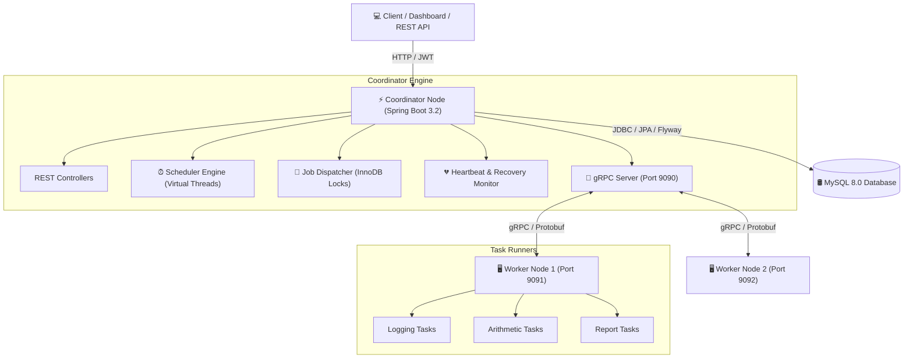
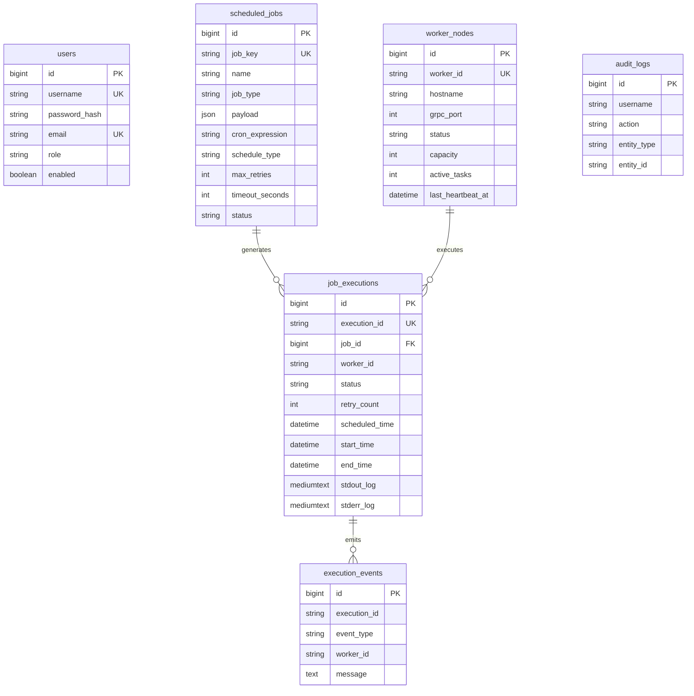

# Distributed Task Scheduler

Enterprise-grade, highly available **Distributed Task Scheduler** built with **Java 21**, **Spring Boot 3.x**, **MySQL 8.0 (InnoDB)**, **Flyway**, **gRPC**, **Protocol Buffers**, and **Java 21 Virtual Threads**.

---

## 🌟 Architectural Features

- **Spring Boot 3.2+ & Java 21 Virtual Threads**: Handles thousands of concurrent task dispatches with lightweight virtual threads (`spring.threads.virtual.enabled=true`).
- **MySQL 8.0 Primary Storage**: Uses MySQL InnoDB as the single source of truth for jobs, workers, executions, events, and audit logs.
- **Atomic Job Claiming**: Implements MySQL InnoDB pessimistic row-level locking (`SELECT FOR UPDATE`) to prevent duplicate task dispatching across clustered nodes.
- **gRPC & Protocol Buffers**: High-performance, low-latency binary RPC communication between the Coordinator and Worker nodes.
- **Flyway Database Migrations**: Versioned schema migrations under `backend/coordinator/src/main/resources/db/migration`.
- **Worker Heartbeat Monitoring & Failover**: Automatic detection of dead/stale worker nodes (missed heartbeats > threshold) with automatic task reassignment and retry mechanisms.
- **Spring Security & JWT**: Role-Based Access Control (`ROLE_ADMIN`, `ROLE_OPERATOR`) with stateless JWT authentication for REST APIs.
- **Control Center Web Dashboard**: React/Vite dashboard served separately from the Spring Boot coordinator.

---

## 🏗 System Architecture Diagram



---

## 🛢️ Database Schema Diagram



---

## ⚙️ Environment Variables

| Variable | Description | Default Value |
| :--- | :--- | :--- |
| `DB_URL` | MySQL JDBC URL | Local development URL |
| `DB_USERNAME` | MySQL username | `root` |
| `DB_PASSWORD` | MySQL password | Required; supply outside source control |
| `PORT` | Coordinator REST port (Render supplies this) | `8080` |
| `CORS_ALLOWED_ORIGINS` | Comma-separated browser origins allowed to call the coordinator | Vercel production URL and local development URLs |
| `GRPC_PORT` | Coordinator gRPC server port | `9090` |
| `COORDINATOR_HOST` | Coordinator hostname used by a worker | `localhost` |
| `COORDINATOR_GRPC_PORT` | Coordinator gRPC port used by a worker | `9090` |
| `WORKER_ID` | Unique worker identifier | `worker-node-1` |
| `WORKER_HOSTNAME` | Worker hostname registered with coordinator | `localhost` |
| `WORKER_PORT` | Worker port registered with coordinator | `9091` |
| `JWT_SECRET` | Base64-encoded JWT signing key (at least 32 bytes) | Required |
| `SCHEDULER_HEARTBEAT_TIMEOUT_SECONDS` | Stale heartbeat threshold | `15` |

---

## 🚀 Setup & Execution Guide

### Prerequisites
1. **Java 21 JDK** installed and configured.
2. **MySQL Server 8.0** running locally or via Docker.
3. **Maven 3.8+**.
4. **Node.js 20+ and npm** for the React/Vite frontend.

### 1. Database Initialization
Ensure MySQL 8.0 is running and create the target database:
```sql
CREATE DATABASE IF NOT EXISTS distributed_scheduler;
```

### 2. Build the Maven Modules
The Maven aggregator and all three modules are under `backend`. Run these commands from the repository root in PowerShell:
```powershell
mvn -f .\backend\pom.xml -pl coordinator -am clean package
mvn -f .\backend\pom.xml -pl worker -am clean package
```

### 3. Run Coordinator Application
Set `DB_URL`, `DB_USERNAME`, `DB_PASSWORD`, and `JWT_SECRET` in the process environment first. Then run:
```powershell
java -jar .\backend\coordinator\target\coordinator-1.0.0-SNAPSHOT.jar
```

### 4. Run Worker Nodes
The worker runs a gRPC server for task dispatch and uses a gRPC client to register with the coordinator and send heartbeats:
```powershell
$env:COORDINATOR_HOST = "localhost"
$env:COORDINATOR_GRPC_PORT = "9090"
$env:WORKER_ID = "worker-node-1"
java -jar .\backend\worker\target\worker-1.0.0-SNAPSHOT.jar
```

Workers expose a gRPC server on `WORKER_PORT` and handle `LOGGING`, `ARITHMETIC`, and `REPORT` task types. The coordinator records successful and failed execution results returned by the worker.

### 5. Access Dashboard
When the frontend is running locally, open:
```
http://localhost:3000/
```
The backend REST API is available at `http://localhost:8080`; health is at `http://localhost:8080/actuator/health`.
Start the frontend from a second terminal:
```powershell
cd .\frontend
npm ci
npm run dev
```
Create an account through the **Register** page first. This project does not seed a default administrator account.

---

## 🐳 Docker Compose Deployment

Copy `.env.example` to `.env`, set unique local values for `DB_PASSWORD` and `JWT_SECRET`, then start the services:

```powershell
Copy-Item .env.example .env
docker compose up --build
```

The coordinator and worker Dockerfiles expect the repository root as their build context so they can copy `backend/pom.xml` and the sibling Maven modules. The repository-root `render.yaml` defines both the public coordinator and a private worker service; both use the repository root as their Docker build context. Create a Render Blueprint from this file, then provide the required `DB_URL`, `DB_USERNAME`, `DB_PASSWORD`, and `JWT_SECRET` values in Render; the database host must be reachable from Render and must not be `localhost`. To create services manually instead, leave **Root Directory** blank, set the Dockerfile path to `backend/coordinator/Dockerfile` or `backend/worker/Dockerfile`, and use `.` (the repository root) as the Docker build context.

---

## ☁️ Deploy to Render + Vercel

1. **Prepare MySQL:** create a MySQL 8 database with a network endpoint reachable from Render. Use the provider's TLS-enabled JDBC URL in `DB_URL`; do not use `localhost` for a hosted database. Render does not provide a managed MySQL database in this blueprint.
2. **Deploy the backend:** push this cleaned project to GitHub, create a Render Blueprint from the repository root, and use `render.yaml`. Set `DB_URL`, `DB_USERNAME`, `DB_PASSWORD`, `JWT_SECRET`, and `CORS_ALLOWED_ORIGINS` in the coordinator service. `JWT_SECRET` must be a Base64-encoded value containing at least 32 random bytes. Set `CORS_ALLOWED_ORIGINS` to your exact Vercel origin (for example `https://your-project.vercel.app`) and any local origins needed for development.
3. **Deploy the worker:** the blueprint defines a private Render service named `distributed-task-scheduler-worker`. It must be in the same Render region as the coordinator so it can reach the coordinator's internal gRPC port `9090`. The private service uses a paid Starter plan; confirm Render's current plan and pricing before creating it.
4. **Deploy the frontend:** import the same GitHub repository in Vercel, set **Root Directory** to `frontend`, build command to `npm run build`, and output directory to `dist`. Add the environment variable `VITE_API_BASE_URL=https://YOUR-COORDINATOR.onrender.com/api/v1` using your actual Render service URL, then redeploy.
5. **Finish CORS:** copy the exact Vercel deployment origin into Render's `CORS_ALLOWED_ORIGINS` environment variable and redeploy the coordinator if needed. Verify `https://YOUR-COORDINATOR.onrender.com/actuator/health`, then register a user and submit a supported task from the Vercel dashboard.

Do not commit `.env` files or production credentials. Configure secrets in Render/Vercel dashboards. A successful build alone does not confirm that the hosted database, service-to-service gRPC connection, or CORS settings are correct; verify these using the deployment logs and health endpoint.

## 🧪 Verification & Failover Demonstration

### 1. Job Creation & Execution
1. Open the dashboard at `http://localhost:3000/`.
2. Navigate to **Scheduled Jobs** and click **+ Create New Job**.
3. Create a **LOGGING**, **ARITHMETIC**, or **REPORT** job. For a CRON schedule, use a Spring six-field expression such as `*/15 * * * * *`.
4. Observe the job automatically being claimed by the Coordinator engine, dispatched over gRPC to `worker-node-1`, and recorded in the MySQL `job_executions` table.

### 2. Demonstrating Worker Timeout & Task Failover Recovery
1. Start a long-running synthetic or shell task on `worker-node-1`.
2. Abruptly kill the worker process (`worker-node-1`).
3. After **15 seconds** (heartbeat timeout threshold), the coordinator heartbeat monitor:
   - Marks the stale worker **OFFLINE**.
   - Queues unfinished executions for retry.
   - Dispatches queued executions to another available worker when one is online.
   - Records execution events in MySQL.
